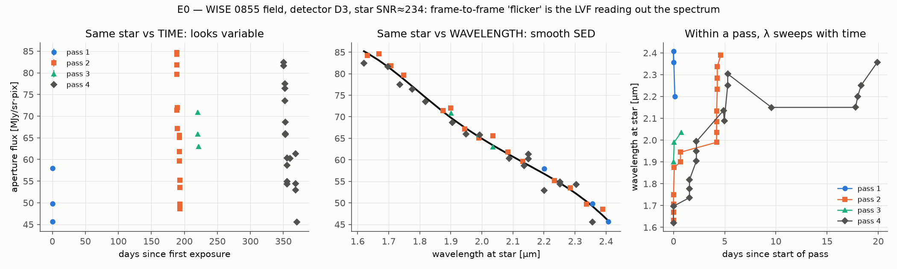
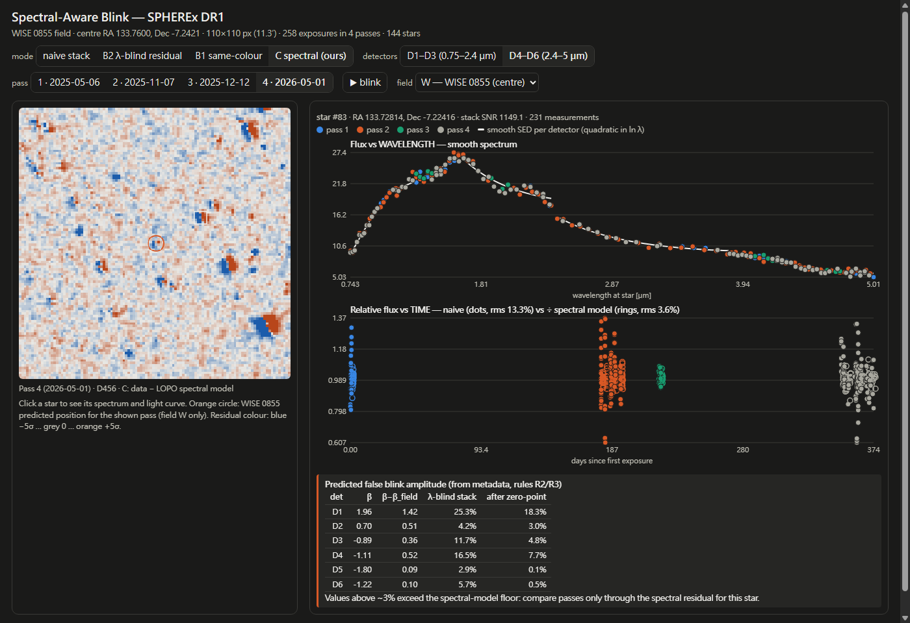
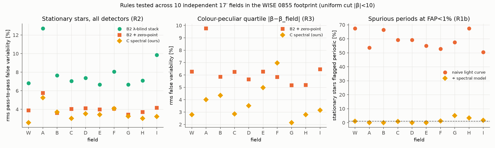

# Spectral-Aware Blink

### Telling *real* motion and variability apart from the rainbow filter in NASA's SPHEREx images

**NASA Space Apps Challenge 2026 · Challenge: *Planet X and SPHEREx* · Local Event: Taichung, Taiwan**
Team: `[TEAM NAME]` · Members: `[MEMBERS]`

**Live tool:** https://murphyjuan.github.io/spectral-aware-blink/web/ · **Demo slides:** [`demo/Spectral-Aware-Blink-slides.pdf`](demo/Spectral-Aware-Blink-slides.pdf)

> **Use of Super Intelligence (SI):** the software, analyses, figures and text in this repository were produced with the help of an SI coding assistant (Claude Code, Anthropic), directed and reviewed by the team. Every source file carries an `SI-assisted` header. See [SI disclosure](#use-of-super-intelligence-si).

---

## The problem in one picture



SPHEREx photographs the whole sky through a **linear variable filter (LVF)**: every row of the detector sees a different colour. As the telescope steps across the sky, a star lands on a different colour in each exposure. Plotted against **time** (left) a perfectly constant star looks like it varies by ~2×; plotted against **wavelength** (middle) it is a smooth spectrum. Inside each survey pass the wavelength **sweeps monotonically with time** (right), so a naive light curve is really the star's spectrum in disguise.

That is a trap for anyone who "blinks" SPHEREx images to find moving objects (brown dwarfs, Planet X candidates) or variable stars — the goal of this challenge.

## What we built

1. **A data pipeline that needs only public NASA files.** IRSA's query services were down all weekend, so we read 64–160-pixel cutouts directly from the public SPHEREx S3 mirror with HTTP range requests (image, variance, zodiacal-light model, flags, and the per-pixel wavelength map), and derive every exposure's wavelength sampling from FITS headers alone.
2. **A spectral model per source and per pixel.** For each star (and each sky pixel) we learn its spectrum from all *other* passes (leave-one-pass-out), predict what it should look like at the colour of this exposure, and subtract. What is left is real change: motion leaves a +/− dipole, variability leaves a coherent residual.
3. **Four comparison methods on the same data** — naive blink, same-colour pairs, detector stacks (the challenge's suggestion), and our spectral model — with identical preprocessing and detectors, judged at equal false-alarm rate.
4. **A web tool** (static, no server): per-pass blink in four modes, click any star to see its spectrum and its light curve before/after removing the spectrum, and a metadata-only warning of how much that star will *fake-blink* in a λ-blind comparison.



## What we found (10 independent 17′ fields, ~5,100 star–detector light curves, 258 exposures)

| # | Finding | Evidence |
|---|---|---|
| 1 | **Naive SPHEREx light curves invent periods.** Inside a pass the wavelength tracks time (\|ρ\| = 0.97 in D3/D6, 0.84 in D2/D5, 0.52 in D1/D4, over 600 sky positions). | Lomb–Scargle flags **50–67%** of *constant* bright stars as periodic (FAP < 1%) with fake periods of 1–8 days; after dividing by the spectrum: **0–5%** (nominal 1%). |
| 2 | **Detector-stack "variability" is predictable from colour.** | Stack-to-stack false variability 6.7–12.7%; predicted from spectrum × wavelength sampling with r = 0.86–0.95; spectral correction brings it to 2.6–5.3% (a simple 2-parameter power law per detector reaches 2.0–3.1%). |
| 3 | **Relative-colour law → brown dwarfs are hit hardest.** After the usual per-image zero-point match, the residual false variability ∝ (β_source − β_field)·Δ⟨ln λ⟩. | r = 0.58–0.89 in all 10 fields; for the most colour-peculiar quartile the spectral model is 1.3–2.4× cleaner in 9/10 fields. Predicted false blink for T/Y dwarfs in D4/D5: **26–36% (median)**, up to 83% — vs a ~3% floor with the spectral model. |
| 4 | **Same-colour pairing fails exactly where cold brown dwarfs are identified.** | In D1/D4 (incl. the 3.3 µm methane band), 17–23% of positions have *no* same-colour partner at 1% tolerance (49–53% at 0.5%). |
| 5 | **WISE 0855 (the coldest known brown dwarf) appears as a moving dipole** in D5/D6 residuals, 3–5σ per pass (~8σ combined, forced at its predicted position), and the dipole flips sign between the first and last pass. | Signal only at 3.9–5 µm, as expected for a Y dwarf. |
| 6 | **Honest negative:** at the *pixel* level, blinking is limited by SPHEREx's undersampled PSF (FWHM ≈ 1.2 px), not by colour. Same-colour pairs, detector stacks and our model recover injected movers within ±10% for star-like colours (naive blink is 2–5× worse); for brown-dwarf colours λ-blind stacks lose ≥1.6×. | 1,920 injected moving sources × 4 passes, equal false-alarm probability. Next step: PSF forward modelling. |



### How this relates to existing work
- The LVF stepping is by design ([Bock et al. 2025](https://arxiv.org/abs/2511.02985)); pixel-level LVF forward models exist for *static* diffuse emission ([Saydjari et al. 2026](https://arxiv.org/abs/2611.12846)), which explicitly lists proper motion and variable stars as open problems. We address that time-domain gap.
- Finding 3 is the LVF analogue of *systematic chromatic errors* in ground surveys ([Li et al. 2016](https://arxiv.org/abs/1601.00117)), but 10× larger; finding 1 parallels scan-law spurious periods in Gaia ([Holl et al. 2023](https://doi.org/10.1051/0004-6361/202245353)).
- The SPHEREx pipeline plans survey-to-survey variability flags, collapsing faint sources into ~10 reference bands ([Akeson et al. 2025](https://arxiv.org/abs/2511.15823)); finding 3 predicts such flags will over-select colour-peculiar sources unless the collapse is spectrum-aware.

## Repository map

| Path | What |
|---|---|
| `web/` | Static web tool (`index.html` + data packs for 4 fields) — served by GitHub Pages |
| `sablink/fetch.py` | S3 range-read cutout fetcher (no IRSA services needed) |
| `sablink/coverage.py` | Header-only wavelength sampling for any sky position |
| `sablink/core.py` | Preprocessing (zodi + mesh background, flags), reprojection, spectral models (P-spline, LOPO) |
| `sablink/bench.py` | Baselines B0/B1/B2, injection of moving sources, matched-filter residual maps |
| `sablink/phot.py` | Source detection and forced aperture photometry |
| `experiments/e0…e9` | E0 problem · E1 residuals · E2 WISE 0855 · E3 injection-recovery · E5 survey geometry · E6 stack law · E7 variability injection · E8 brown-dwarf prediction · E9 spurious periods |
| `results/figs/` | All figures · `results/summary/` per-field metrics |

Reproduce (Python 3.12+, `pip install astropy fsspec aiohttp scipy pandas matplotlib`):
```bash
python sablink/fetch.py data/meta/sia_spherex_wise0855_20261114.csv 133.7600 -7.2421 160 data/cache/w0855_160 32
BKG_BOX=16 python experiments/e0_problem.py data/cache/w0855_160 133.7600 -7.2421 110 results/e0_fW
python experiments/e6_b2law.py results/e0_fW/e0_phot.npz results/e6b_fW
python experiments/e9_periodogram.py results/e0_fW/e0_phot.npz
python sablink/coverage.py data/meta/sia_spherex_wise0855_20261114.csv data/cov.npz 32
python experiments/e5_coverage.py data/cov.npz 133.76 -7.2421 1.6 600 results/e5
```

## Limitations
- One 3.5° SPHEREx field (WISE 0855, Galactic latitude +23°) because IRSA's SIA service returned errors all weekend; 10 sub-fields inside it. Other ecliptic latitudes (deep fields) and the crowded Galactic plane are untested.
- Brown-dwarf spectra in finding 3 are schematic templates (correct band positions, approximate depths).
- WISE 0855 was measured at its known position; a fully blind search still has to beat the PSF-dipole false alarms of finding 6.
- Literature check covered arXiv/OpenAlex and seven full texts, not ADS full-text or the SPHEREx Explanatory Supplement.

## NASA data and resources
- SPHEREx DR1 Level-2 spectral images (IMAGE, VARIANCE, ZODI, FLAGS, WCS-WAVE) from the public NASA/IPAC IRSA AWS mirror `s3://nasa-irsa-spherex` (`dr1/level2/`), 258 exposures covering WISE 0855−0714.
- IRSA SPHEREx SIA metadata for WISE 0855 (saved 2025-11-14), IRSA SPHEREx documentation and tutorials.
- NASA WISE / NEOWISE context (WiseView, Backyard Worlds) for the blink concept; target coordinates and proper motions from SIMBAD (CDS) via Sesame; 2MASS (IPAC/NASA) for one blend check.

## Use of Super Intelligence (SI)
The project concept (spectral-model differencing for SPHEREx blink, with injection-recovery validation) was defined by the team. An SI coding assistant (Claude Code, Anthropic) was used to write and debug the code, run and analyse experiments, search and summarise literature, generate the figures and the web tool, and draft the documentation. All code files carry an `SI-assisted` header; figures were generated programmatically by that code (no image-generation models). The team reviewed the results and decided what to claim.

## References
Bock et al. 2025 (arXiv:2511.02985) · Akeson et al. 2025 (arXiv:2511.15823) · Saydjari et al. 2026 (arXiv:2611.12846) · Gagné et al. 2026 (arXiv:2604.22012) · Rustamkulov et al. 2026 (arXiv:2607.00543) · Hui et al. 2026 (arXiv:2602.09139) · Li et al. 2016 (arXiv:1601.00117) · Holl et al. 2023 (A&A, doi:10.1051/0004-6361/202245353) · Binnenfeld et al. 2026 (arXiv:2611.08282) · VanderPlas & Ivezić 2015 (arXiv:1502.01344) · Schlanger et al. 2026 (arXiv:2607.18054) · Meisner et al. 2022 (arXiv:2209.14327) · Luhman 2014 (ApJL 786, L18).
Software: Astropy, NumPy, SciPy, pandas, Matplotlib, fsspec/aiohttp, Pillow. Colour palette for charts adapted from a validated colour-blind-safe reference palette.

License: MIT (code). Data: NASA/IPAC IRSA public data.
